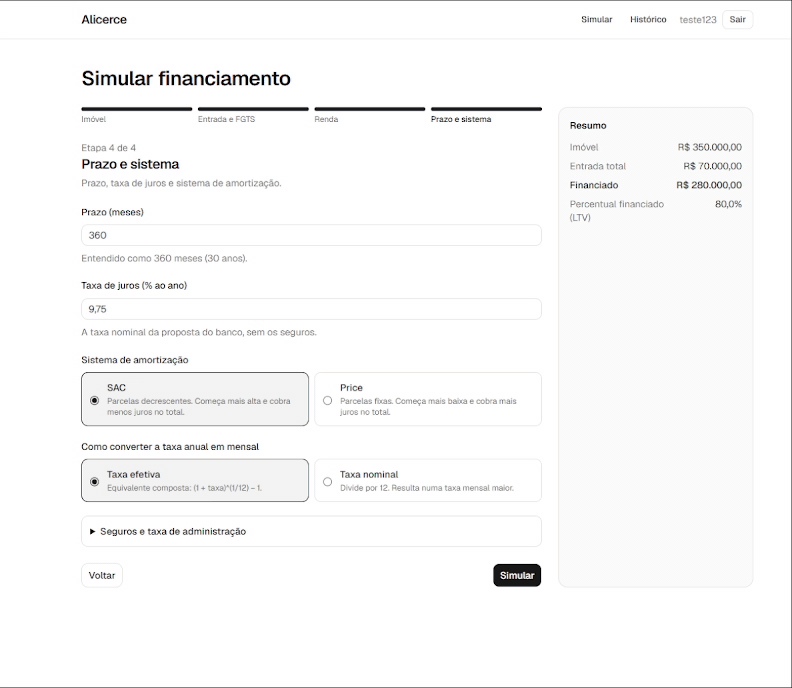

# Alicerce Web

[](https://github.com/NatanFurletti/Alicerce-web/actions/workflows/ci.yml)


> Front-end do [Alicerce](https://github.com/NatanFurletti/alicerce-api), um simulador de
> financiamento imobiliário que mostra a conta inteira: SAC x Price, CET, comprometimento de
> renda e a tabela de amortização mês a mês.

**Deploy:** o link entra aqui assim que a publicação na Vercel for concluída.



_Última etapa do simulador e o resultado de uma simulação em SAC: resumo, comprometimento da
renda, comparativo SAC x Price, gráficos e tabela. Depois, a mesma simulação em Price._

---

## Objetivo

Sou desenvolvedor backend, e a [API Alicerce](https://github.com/NatanFurletti/alicerce-api) é a
peça central do meu portfólio. Este front existe para mostrar a outra metade: consumir uma API
real com autenticação, contrato tipado, regras de negócio e erros de verdade, num front em React
com o mesmo cuidado de testes e arquitetura.

## Funcionalidades

- **Cadastro e login** com JWT, renovação automática do token e rotas protegidas.
- **Simulador em 4 etapas**: imóvel, entrada e FGTS, renda, e prazo e sistema. A validação
  acontece em cada etapa, e o resumo do financiamento aparece ao vivo.
- **Resultado completo**:
  - valor financiado, primeira e última parcela, total pago, total de juros e CET;
  - alerta de comprometimento de renda, com aviso a partir de 25% e alerta acima de 30%;
  - comparativo SAC x Price lado a lado;
  - gráficos de evolução do saldo devedor e da composição de cada parcela;
  - tabela de amortização paginada, com exportação para CSV.
- **Histórico** paginado das simulações, com exclusão confirmada.

## Stack

| Camada             | Escolha                                                           |
| ------------------ | ----------------------------------------------------------------- |
| Framework          | Next.js 16 (App Router, Cache Components) + React 19              |
| Linguagem          | TypeScript em modo `strict`                                       |
| Estilo             | Tailwind CSS v4 + shadcn/ui (sobre Base UI)                       |
| Formulários        | React Hook Form + Zod                                             |
| Dados              | TanStack Query                                                    |
| Contrato com a API | Tipos gerados do OpenAPI (`openapi-typescript`) + `openapi-fetch` |
| Gráficos           | Recharts                                                          |
| Testes             | Vitest + Testing Library                                          |
| Qualidade          | ESLint + Prettier + GitHub Actions                                |

---

## Como rodar junto com a API

**Pré-requisitos:** Node.js 20.11+ e Docker.

### 1. Suba a API

```bash
git clone https://github.com/NatanFurletti/alicerce-api.git
cd alicerce-api
docker compose up
```

A API sobe em `http://localhost:3000`, já com `CORS_ORIGINS=http://localhost:3001` liberando o
front.

### 2. Suba o front

```bash
git clone https://github.com/NatanFurletti/Alicerce-web.git
cd Alicerce-web
cp .env.example .env.local
npm install
npm run dev
```

Abra `http://localhost:3001`. O front usa a porta **3001** porque a API ocupa a 3000.

### Variáveis de ambiente

| Variável              | Para quê        | Padrão                  |
| --------------------- | --------------- | ----------------------- |
| `NEXT_PUBLIC_API_URL` | URL base da API | `http://localhost:3000` |

Ela é embutida no bundle durante o build, então trocá-la exige um novo build.

## Scripts

| Script                 | O que faz                                                                                              |
| ---------------------- | ------------------------------------------------------------------------------------------------------ |
| `npm run dev`          | Servidor de desenvolvimento na porta 3001                                                              |
| `npm run build`        | Build de produção                                                                                      |
| `npm run lint`         | ESLint, incluindo a regra que isola a camada de serviço                                                |
| `npm run typecheck`    | Gera os tipos das rotas e roda o `tsc`                                                                 |
| `npm test`             | Testes com Vitest                                                                                      |
| `npm run format`       | Formata com Prettier                                                                                   |
| `npm run generate:api` | Regenera os tipos da API a partir do OpenAPI (`OPENAPI_URL`, padrão `http://localhost:3000/docs-json`) |

---

## Arquitetura

```
src/
├── app/                     # Rotas: só montam a página
│   ├── (auth)/              #   /entrar, /cadastrar
│   └── (privado)/           #   /simular, /simulacoes, /simulacoes/[id] (exigem login)
├── features/                # Regras de tela, por domínio
│   ├── auth/                #   {components, hooks, schemas, services, session}
│   ├── simulacao/           #   {components, hooks, lib, schemas, services}
│   └── historico/           #   {components, hooks, lib, services}
├── components/              # Compartilhados; ui/ é o shadcn/ui
└── lib/
    ├── api/                 # Cliente tipado, erros e schema.d.ts (gerado)
    └── format.ts, money.ts  # Formatação pt-BR e conversões de unidade
```

### Camadas

```
Componente → Hook → Serviço → cliente openapi-fetch → API
(exibe)     (cache)  (contrato)  (HTTP tipado)
```

- **Componentes** exibem dados e tratam os estados de carregamento, erro e vazio. Nunca fazem
  HTTP.
- **Hooks** concentram o cache do TanStack Query: chaves, invalidação após mutações e
  paginação.
- **Serviços** (`features/*/services`) são a única camada que fala com a API.
- **`lib/`** guarda o que é genérico: cliente HTTP, formatação e conversões.

A regra "componente não chama a API" é **garantida pelo ESLint** (`no-restricted-imports`), e não
só por convenção: importar o cliente HTTP fora de `services/` quebra o lint.

---

## Decisões técnicas

### Contrato gerado a partir do OpenAPI

Os tipos de requisição e resposta vêm do Swagger da API (`npm run generate:api`). Se a API mudar
um campo e os tipos forem regenerados, o front deixa de compilar onde usava o formato antigo. O
arquivo gerado é versionado: o build não depende da API estar no ar, e uma mudança de contrato
aparece no diff.

Para isso funcionar, a API precisou documentar os schemas de **resposta**, e antes só as entradas
estavam no Swagger. Fiz essa mudança no back-end com um teste que reprova qualquer rota nova sem
schema
([ADR-032](https://github.com/NatanFurletti/alicerce-api/blob/main/docs/decisions.md)).

### Erros da API viram mensagens e voltam ao campo certo

A API devolve `{ code, message }`, e o `code` é estável. O front escolhe o texto em pt-BR pelo
`code` (`INVALID_CREDENTIALS` → "E-mail ou senha inválidos.") e guarda a mensagem original só para
depuração.

Regras de negócio recusadas com 422 levam o usuário **ao campo que resolve o problema**. Um
`LTV_EXCEEDED` no fim do formulário volta para a etapa da entrada, com o erro e o foco no campo.

### Sessão: onde ficam os tokens

| Token            | Onde fica      | Por quê                                                           |
| ---------------- | -------------- | ----------------------------------------------------------------- |
| Access (15 min)  | Só em memória  | Dá acesso imediato à API. Não persistir reduz o estrago de um XSS |
| Refresh (7 dias) | `localStorage` | Mantém a sessão depois de um F5                                   |

**Trade-off assumido:** um script injetado (XSS) consegue ler o refresh token. A alternativa mais
segura seria um cookie httpOnly com um proxy no Next.js (BFF), que esconde o token do JavaScript.
Ela foi descartada pela simplicidade, e as mitigações são o React escapando todo texto renderizado,
a ausência de `dangerouslySetInnerHTML` e o CORS restrito na API.

### Renovação de token única e compartilhada

Um middleware do `openapi-fetch` injeta o token e, num 401, renova a sessão e repete a requisição
uma vez. A página de resultado dispara várias requisições em paralelo, e se o token expirou, todas
tomam 401 ao mesmo tempo. Com o `singleFlight`, elas esperam **uma única** chamada a
`/auth/refresh`, em vez de uma cada.

### Dinheiro nunca em ponto flutuante

A API trabalha com **centavos inteiros**. O formulário aceita reais e percentuais como o usuário
digita ("500.000,00", "9,75" ou "9.75"), e mostra como entendeu o valor. A conversão para o
formato da API acontece **num único lugar** (`toCreateSimulationBody`), com dois cuidados:

- entrada e FGTS são somados **depois** de convertidos em centavos, porque em reais
  `19.99 + 0.01` já sai com erro de ponto flutuante;
- taxas são arredondadas para as 10 casas decimais que a API aceita. A divisão pura
  `0.07 / 100` gera `0.0007000000000000001`, e a requisição voltaria com 400.

### Comparativo SAC x Price sem a renda

A API valida a renda contra os dois sistemas no `/compare`. Num teste contra a API real, com
renda de R$ 12.500, o Price comprometia 27,7% e passava, mas o SAC comprometeria 35%, e a
comparação inteira voltaria com 422. O front pede a comparação **sem a renda** e calcula o
comprometimento de cada sistema na tela. Um teste garante que a renda nunca vai para esse
endpoint.

### Cache Components (Next.js 16)

Com `cacheComponents`, o Next pré-renderiza também os Client Components. Por isso, todo trecho
que depende da requisição (dados do usuário, `?redirect=`, `?pagina=`) fica atrás de `<Suspense>`
com skeleton, e o resto da página é entregue estático e imediato. A opção foi mantida porque vai
ser obrigatória na próxima versão major do Next.

### Gráficos acessíveis

- As cores das séries vêm de uma paleta **validada por script** para daltonismo e contraste, nos
  temas claro e escuro.
- Cada gráfico tem uma descrição em texto ("O saldo começa em R$ 280.000,00 e chega a zero no mês
  360").
- A tabela de amortização logo abaixo é a alternativa completa em texto.
- O nível de comprometimento de renda é informado por ícone e texto, nunca só pela cor.

### CSV que o Excel em português abre direto

- separador `;`;
- vírgula decimal, sem separador de milhar (`400000,00` é número; `400.000,00` viraria texto);
- BOM no início, para os acentos aparecerem certos;
- conversão de centavos para texto sem passar por ponto flutuante.

---

## Testes

**154 testes** em 26 arquivos, rodando no CI a cada push.

| O que é testado                                 | Como                                                                                                  |
| ----------------------------------------------- | ----------------------------------------------------------------------------------------------------- |
| Conversões, formatação, parser de números pt-BR | Unitários, escritos **antes** da implementação (TDD)                                                  |
| Schemas Zod (login, cadastro, simulador)        | Unitários, incluindo a regra entre campos e o limite de 72 bytes da senha                             |
| Middleware de autenticação                      | Com o `openapi-fetch` real e uma API simulada: renovação única, repetição do POST com o corpo intacto |
| Fluxo do simulador                              | Testing Library: as 4 etapas, o corpo exato enviado à API e o 422 levando de volta ao campo           |
| Resultado e histórico                           | Resumo, comparativo, paginação, CSV, exclusão confirmada, estados de erro e vazio                     |

Duas práticas para confiar nos testes:

- **Validação por mutação.** Quebrei de propósito trechos críticos (renovação sem
  compartilhamento, redirect aceitando `//`, `signOut` mantendo o token, exclusão sem
  confirmação…) e conferi se algum teste falhava. Um teste que passou mesmo com o código quebrado
  revelou que os testes de data dependiam do fuso da máquina. Hoje eles rodam em UTC.
- **Teste contra a API real.** Além dos testes com a API simulada, cada etapa foi conferida
  contra a API rodando localmente.

---

## Deploy na Vercel

1. Importe o repositório na Vercel. O framework Next.js é detectado sozinho.
2. Em **Environment Variables**, defina `NEXT_PUBLIC_API_URL` com a URL da API, sem barra final.
3. Faça o deploy.
4. Na API (Render → Environment), inclua a URL da Vercel em `CORS_ORIGINS`. Sem isso, o
   navegador recusa as chamadas do front.

A API fica no plano gratuito do Render e hiberna sem uso: a primeira chamada pode levar até um
minuto. A mensagem de erro de rede do front avisa isso.

## Limitações conhecidas

- **Sem logout no servidor.** Os tokens da API são stateless, e "Sair" apaga os tokens do
  navegador. Um token já emitido vale até expirar (decisão da API, ADR-006).
- **`npm audit` aponta vulnerabilidades em dependências de desenvolvimento** (`braces`, via
  `eslint-config-next`). Elas não chegam ao bundle, e a correção forçada quebraria o ESLint do
  Next.
- **Sem testes de navegador ponta a ponta.** Os fluxos são testados com Testing Library e
  conferidos contra a API real. Playwright é o próximo passo natural.

---

## Autor

**Natan Furletti** — desenvolvedor backend

[LinkedIn](https://www.linkedin.com/in/natan-furletti/) · [GitHub](https://github.com/NatanFurletti)
